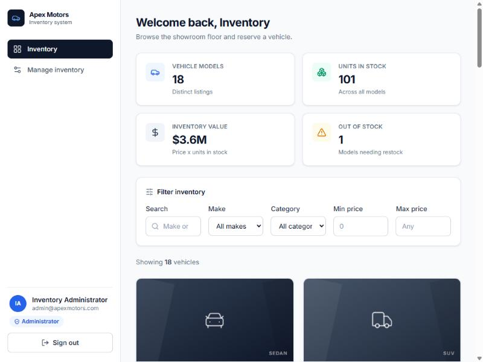
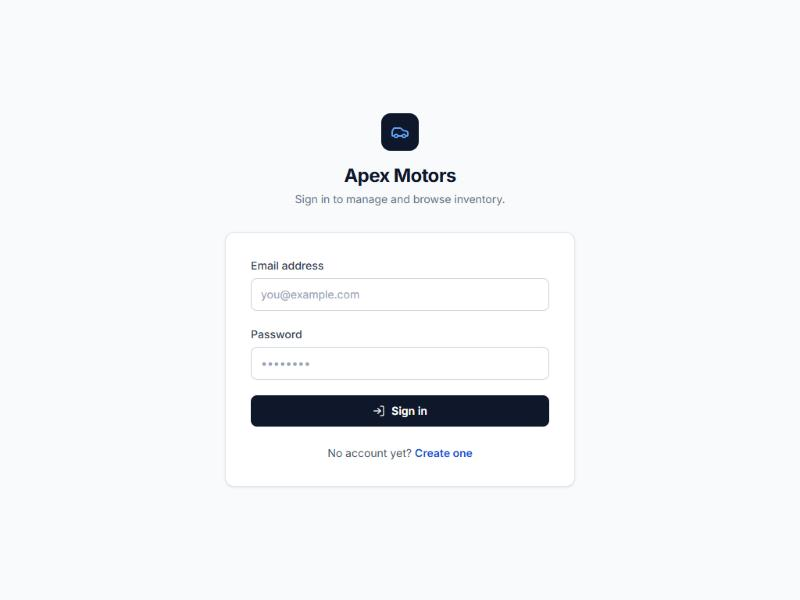
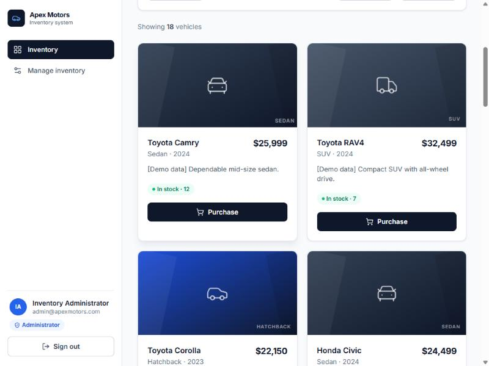
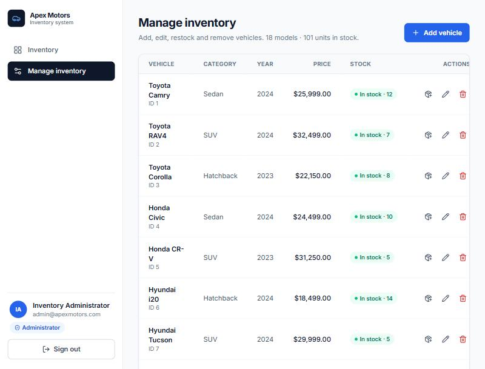
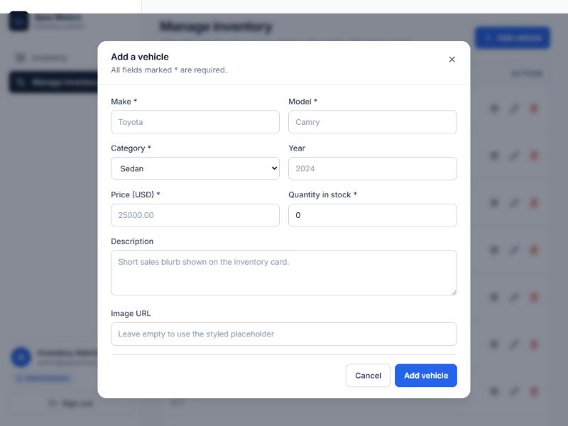
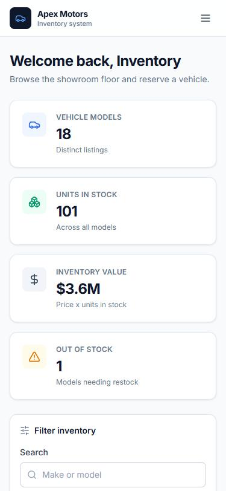

# Car Dealership Inventory System

A full-stack inventory management system for a car dealership, built with
FastAPI, PostgreSQL and React, and developed test-first.

Customers register, browse and search the showroom, and purchase vehicles.
Administrators additionally add, edit, restock and delete inventory. Stock is
decremented atomically in the database, so the last unit of a vehicle can never
be sold twice.



---

## Contents

- [Status](#status)
- [Features](#features)
- [Technology stack](#technology-stack)
- [Architecture](#architecture)
- [Prerequisites](#prerequisites)
- [PostgreSQL setup](#postgresql-setup)
- [Backend setup](#backend-setup)
- [Creating the first administrator](#creating-the-first-administrator)
- [Seeding demonstration data](#seeding-demonstration-data)
- [Frontend setup](#frontend-setup)
- [API reference](#api-reference)
- [Access control: a documented interpretation](#access-control-a-documented-interpretation)
- [Concurrency safety](#concurrency-safety)
- [Testing](#testing)
- [Screenshots](#screenshots)
- [Security notes](#security-notes)
- [My AI Usage](#my-ai-usage)
- [Known limitations](#known-limitations)

---

## Status

| Check | Result |
|---|---|
| Backend tests (pytest) | 143 passed, 0 failed |
| Backend statement coverage on `app/` | 96% |
| Backend lint (ruff) | clean |
| Frontend tests (Vitest + React Testing Library) | 60 passed, 0 failed |
| Frontend lint (ESLint 9) | clean |
| Frontend production build | succeeds |

Measured on 2026-10-24. Full command output is in [TEST_REPORT.md](TEST_REPORT.md).

---

## Features

**Authentication**
- Registration with validated, normalised (trimmed, lowercased) email addresses.
- Duplicate emails rejected, including addresses differing only in case.
- Passwords hashed with bcrypt; hashes never appear in any API response.
- JWT access tokens with a configurable expiry, verified on every request.
- Public registration can never create an administrator — the role is not read
  from the request body at all.

**Inventory**
- Browse the full catalogue with optional pagination.
- Search by free text (make *or* model), make, model, category and price range;
  every filter combines, and text matching is case-insensitive substring
  matching with LIKE wildcards escaped.
- Purchase a vehicle: stock drops by exactly one, atomically.
- Out-of-stock purchases are rejected with 409, and stock can never go negative.

**Administration**
- Add, edit and delete vehicles; delete requires confirmation in the UI.
- Restock by a positive integer amount, applied atomically.
- Regular users are blocked from all of the above by the API, not just the UI.

**Interface**
- Summary statistics computed from real API data.
- Responsive from phone to desktop, with no horizontal overflow.
- Loading, empty and error states throughout; toast notifications for results.
- Vehicles without an image get a styled per-category placeholder, so no card
  ever shows a broken image.

---

## Technology stack

**Backend** — Python 3.13, FastAPI 0.115, SQLAlchemy 2.0, PostgreSQL 16,
Alembic 1.13, Pydantic v2, PyJWT 2.9, bcrypt 4.2, psycopg 3, Uvicorn,
pytest 8.3 + pytest-cov, HTTPX (via Starlette's `TestClient`), ruff.

**Frontend** — React 18, Vite 6, JavaScript, Tailwind CSS 3.4,
React Router 6, Axios, lucide-react, Vitest 2 + React Testing Library, ESLint 9.

**Infrastructure** — Docker Compose for PostgreSQL.

---

## Architecture

```text
car-dealership-inventory/
├── backend/
│   ├── app/
│   │   ├── main.py              FastAPI app, CORS, router registration
│   │   ├── core/
│   │   │   ├── config.py        Settings from the environment
│   │   │   ├── security.py      bcrypt hashing, JWT issue/verify
│   │   │   └── dependencies.py  get_current_user, require_admin
│   │   ├── db/                  Declarative base, engine, session
│   │   ├── models/              User and Vehicle ORM models
│   │   ├── schemas/             Pydantic request/response models
│   │   ├── api/                 auth.py, vehicles.py routers
│   │   ├── repositories/        Query building, atomic stock updates
│   │   ├── services/            Business rules, domain errors
│   │   └── utils/               seed.py, create_admin.py
│   ├── tests/
│   │   ├── conftest.py          Fixtures against a real test database
│   │   ├── unit/                Pure unit tests (hashing, JWT)
│   │   └── integration/         API tests through the whole stack
│   └── alembic/                 Migrations
├── frontend/
│   └── src/
│       ├── components/          VehicleCard, VehicleForm, route guards, …
│       ├── pages/               Login, Register, Dashboard, Admin, Details, 404
│       ├── context/             AuthContext, ToastContext
│       ├── services/            Centralised API client
│       └── utils/               Formatting and inventory summaries
├── screenshots/
├── docker-compose.yml
└── initdb/                      Creates the test database on first boot
```

Requests flow **router → service → repository → database**. Routers deal only
in HTTP concerns; services raise domain errors (`VehicleNotFoundError`,
`OutOfStockError`) that routers map to status codes; repositories build every
query with SQLAlchemy constructs, so user input is always a bound parameter.

---

## Prerequisites

| Software | Version used |
|---|---|
| Python | 3.13.17 (3.11+ works) |
| Node.js | 24.22.1 (18+ works) |
| npm | 11.19.1 |
| PostgreSQL | 16.15 |
| Docker Desktop | for the bundled PostgreSQL |

PostgreSQL may be installed natively instead of using Docker; just point
`DATABASE_URL` at it.

---

## PostgreSQL setup

### Option A — Docker Compose (what this project uses)

```powershell
docker compose up -d
```

This starts PostgreSQL 16 on `localhost:5432`, creates the `dealership`
database, and runs `initdb/01-create-test-db.sql` to create `dealership_test`.
The init script only runs on a **fresh** volume.

Check it is healthy before running anything else:

```powershell
docker inspect -f '{{.State.Health.Status}}' dealership-db
```

### Option B — an existing PostgreSQL server

```sql
CREATE USER dealer WITH PASSWORD '<your-password>';
CREATE DATABASE dealership OWNER dealer;
CREATE DATABASE dealership_test OWNER dealer;
```

Both databases are required: the test suite runs against `dealership_test` and
will refuse to touch the development database.

---

## Backend setup

All commands are Windows PowerShell, run from the repository root.

**1. Activate the virtual environment**

```powershell
cd backend
.\venv\Scripts\Activate.ps1
```

If the environment does not exist yet:

```powershell
python -m venv venv
.\venv\Scripts\Activate.ps1
pip install -r requirements.txt
```

**2. Configure the environment**

```powershell
Copy-Item .env.example .env
```

Then edit `backend\.env` and set real values:

```ini
DATABASE_URL=postgresql+psycopg://dealer:<password>@localhost:5432/dealership
TEST_DATABASE_URL=postgresql+psycopg://dealer:<password>@localhost:5432/dealership_test
JWT_SECRET=<a long random string>
JWT_ALGORITHM=HS256
JWT_EXPIRE_MINUTES=60
CORS_ORIGINS=http://localhost:5173,http://127.0.0.1:5173
```

Generate a strong secret:

```powershell
python -c "import secrets; print(secrets.token_urlsafe(48))"
```

`.env` is gitignored and must never be committed.

**3. Run the migrations**

```powershell
alembic upgrade head
```

To migrate the test database too (the test suite does this automatically, but
it is useful to verify):

```powershell
$env:ALEMBIC_DATABASE_URL = $env:TEST_DATABASE_URL
alembic upgrade head
Remove-Item Env:\ALEMBIC_DATABASE_URL
```

**4. Start the API**

```powershell
python -m uvicorn app.main:app --reload
```

The API is then on <http://localhost:8000>, with interactive docs at
<http://localhost:8000/docs> and a health check at `/api/health`.

---

## Creating the first administrator

Public registration always creates a regular user, so the first administrator
is created by a script that reads credentials from the environment. Nothing is
hardcoded, and no credentials are passed on the command line.

```powershell
cd backend
$env:ADMIN_EMAIL = "admin@yourdomain.com"
$env:ADMIN_NAME = "Inventory Administrator"
$env:ADMIN_PASSWORD = "<a strong password>"
python -m app.utils.create_admin
```

The script is safe to re-run: an existing account with that email is promoted
to administrator, and its password is left alone unless you pass
`--reset-password`.

The email is validated with exactly the same rules the login endpoint uses, so
it is impossible to create an administrator who cannot sign in. (Note that
reserved TLDs such as `.local` are rejected — use a real domain.)

---

## Seeding demonstration data

```powershell
cd backend
python -m app.utils.seed
```

This loads 18 vehicles across 8 manufacturers and 5 categories, with varied
prices and quantities including two out-of-stock models. Every description is
prefixed `[Demo data]` so seeded rows are obvious.

The operation is **idempotent**, keyed on `(make, model)`: re-running updates
the existing demo rows rather than creating duplicates.

Seed rows deliberately have no `image_url`. Rather than link to third-party
images that may rot or carry unclear licensing, the frontend renders its own
styled placeholder per category.

---

## Frontend setup

```powershell
cd frontend
npm install
Copy-Item .env.example .env
npm run dev
```

The app runs on <http://localhost:5173>.

`frontend\.env` holds a single variable:

```ini
VITE_API_BASE_URL=http://localhost:8000
```

Everything prefixed `VITE_` is compiled into the public JavaScript bundle, so
**no secret may ever be put in this file**.

Other commands:

```powershell
npm run build      # production build into dist/
npm run preview    # serve the production build
npm test           # run the test suite once
npm run lint       # ESLint
```

---

## API reference

Interactive documentation (Swagger UI) is at <http://localhost:8000/docs>, with
the raw schema at `/openapi.json`.

| Method | Endpoint | Access | Purpose |
|---|---|---|---|
| POST | `/api/auth/register` | Public | Create a customer account |
| POST | `/api/auth/login` | Public | Exchange credentials for a JWT |
| GET | `/api/auth/me` | Authenticated | The current user |
| GET | `/api/vehicles` | Authenticated | List inventory |
| GET | `/api/vehicles/search` | Authenticated | Filter inventory |
| GET | `/api/vehicles/{id}` | Authenticated | One vehicle |
| POST | `/api/vehicles` | **Admin** | Create a vehicle |
| PUT | `/api/vehicles/{id}` | **Admin** | Update a vehicle |
| DELETE | `/api/vehicles/{id}` | **Admin** | Delete a vehicle |
| POST | `/api/vehicles/{id}/purchase` | Authenticated | Buy one unit |
| POST | `/api/vehicles/{id}/restock` | **Admin** | Add units to stock |
| GET | `/api/health` | Public | Liveness check |

Authenticate by sending `Authorization: Bearer <token>`.

### Registration

```http
POST /api/auth/register
{ "name": "John Doe", "email": "john@example.com", "password": "SecurePass123!" }
```

Returns `201` with the created user. Any `role` in the body is ignored.
A duplicate email returns `409`; invalid input returns `422`.

### Login

```http
POST /api/auth/login
{ "email": "john@example.com", "password": "SecurePass123!" }
```

Returns `{ "access_token": "<JWT>", "token_type": "bearer" }`, or `401`.

### Creating a vehicle

```http
POST /api/vehicles
{ "make": "Toyota", "model": "Camry", "category": "Sedan",
  "price": "25000.00", "quantity": 10 }
```

`year`, `description` and `image_url` are optional. Returns `201`.

### Searching

```http
GET /api/vehicles/search?make=Toyota&category=Sedan&min_price=15000&max_price=35000
```

Supported parameters: `q` (free text, matches make **or** model), `make`,
`model`, `category`, `min_price`, `max_price`, `limit`, `offset`. All combine.
A `min_price` above `max_price` returns `422`.

`/api/vehicles/search` is registered before `/api/vehicles/{id}`, so it is
never parsed as an identifier.

### Purchasing

```http
POST /api/vehicles/{id}/purchase
```

Returns the updated vehicle. `409` if out of stock, `404` if it does not exist.

### Restocking

```http
POST /api/vehicles/{id}/restock
{ "quantity": 5 }
```

Returns the updated vehicle. Zero, negative or non-integer quantities return
`422`; a missing vehicle returns `404`.

### Monetary values

Prices are stored as PostgreSQL `NUMERIC(12,2)` and handled as Python
`Decimal`. They are serialised as JSON **strings** (`"25999.00"`), not floats,
so no precision is lost in transit. The frontend converts only at the point of
display.

---

## Access control: a documented interpretation

The kata specifies `POST /api/vehicles` and `PUT /api/vehicles/{id}` as
"protected" but does not say which role may call them.

**This project restricts both to administrators**, because changing the
catalogue is an inventory-management action rather than something a customer
should do. Every endpoint still rejects anonymous callers with `401`, which is
the behaviour the kata requires, and the choice is asserted explicitly in
`backend/tests/integration/test_permissions.py`.

If a grader expects any authenticated user to create and update vehicles, the
change is to swap the `AdminUser` dependency for `CurrentUser` on those two
routes in `backend/app/api/vehicles.py` and update the two corresponding tests.

Summary of the enforced matrix:

| Action | Anonymous | Customer | Administrator |
|---|---|---|---|
| Browse / search / view | 401 | ✅ | ✅ |
| Purchase | 401 | ✅ | ✅ |
| Create / update | 401 | 403 | ✅ |
| Delete / restock | 401 | 403 | ✅ |

This is enforced by the API itself, not by hiding buttons. Verified in a
browser: a regular user's token returns `403` on create, delete and restock
even when the request is made directly from the console.

---

## Concurrency safety

Purchasing is a single conditional statement:

```sql
UPDATE vehicles SET quantity = quantity - 1
WHERE id = :id AND quantity > 0
RETURNING *;
```

Because the `quantity > 0` predicate lives inside the `UPDATE`, two concurrent
purchases of the last unit cannot both succeed: PostgreSQL re-evaluates the
predicate against the committed row version once the row lock is released, so
the second statement matches zero rows and the request gets `409`. A
`CHECK (quantity >= 0)` constraint backs this up at the schema level.

This is tested for real, not asserted in a comment. Two tests fire 8 and 10
genuinely concurrent purchases through a thread pool, each on its own database
connection, and require exactly 1 and exactly 3 successes respectively.

To confirm those tests are not vacuous, the atomic update was temporarily
replaced with a naive read-then-write. Both tests failed immediately — the
naive version sold **10 units from a stock of 3**. Restoring the atomic version
made them pass again.

---

## Testing

### Backend

PostgreSQL must be running first.

```powershell
cd backend
.\venv\Scripts\Activate.ps1
pytest
```

With a coverage report:

```powershell
pytest --cov=app --cov-report=term-missing --cov-report=html
```

The HTML report is written to `backend/htmlcov/index.html`.

Tests run against `TEST_DATABASE_URL`, never the development database. The
schema is built by running the real Alembic migrations once per session, and
tables are truncated between tests — which keeps genuine `COMMIT`s available
for the concurrency tests.

Skip the slower concurrency tests with `pytest -m "not slow"`.

### Frontend

```powershell
cd frontend
npm test
npm run test:watch
```

### Lint

```powershell
cd backend; .\venv\Scripts\ruff.exe check app tests
cd frontend; npm run lint
```

---

## Screenshots

All captured from the running application against the seeded database.

| | |
|---|---|
|  |  |
| Sign in | Dashboard with live statistics |
|  |  |
| Inventory cards | Administrator management table |
|  |  |
| Add-vehicle dialog | Mobile layout |

`screenshots/07-mobile-cards.jpg` shows the mobile inventory cards.

---

## Security notes

Implemented:

- bcrypt password hashing, with input normalised to bcrypt's 72-byte limit so
  long passwords cannot cause an error or be silently mishandled.
- JWT signature and expiry verified on every request; tokens for deleted users
  are rejected.
- Role checks in reusable dependencies (`get_current_user`, `require_admin`).
- `401` for unauthenticated, `403` for insufficient permissions.
- All input validated by Pydantic; all SQL built through SQLAlchemy with bound
  parameters; LIKE wildcards escaped in search terms.
- Database-level constraints as a final backstop: positive price, non-negative
  quantity, non-blank text, valid role, unique email.
- CORS restricted to configured origins.
- Secrets read from the environment; `.env` files gitignored.

**Token storage — stated honestly.** The access token is held in memory and
mirrored to `sessionStorage` so that refreshing the page does not sign the user
out. `sessionStorage` is readable by any JavaScript running on the origin, so
**this is not immune to XSS** — no JS-accessible storage is. It is a pragmatic
choice for an assessment SPA. A production system should have the backend issue
an `httpOnly`, `Secure`, `SameSite` cookie that page scripts cannot read, with
CSRF protection alongside it.

---

## My AI Usage

### Tools used

- **Claude Code** (Claude Opus 5), used as an autonomous coding agent inside
  the repository for effectively all of the implementation: planning,
  writing tests and production code, running the suite, debugging failures,
  driving a browser to verify the application end-to-end, and writing
  documentation.

> _If any other AI tool (for example ChatGPT) was used on this project,
> add it here along with what it contributed, before submitting._

### How AI was used

**Planning.** The repository was audited first — existing structure, pinned
dependencies, git history, database connectivity — and the implementation was
sequenced into phases from that audit rather than from assumptions. A running
log was kept in [PROGRESS.md](PROGRESS.md).

**Implementation.** Models, schemas, migrations, services, repositories,
routers, the React application and both test suites were written by the agent.
Design decisions that the kata left open were decided explicitly and written
down rather than chosen silently — most importantly the admin-only
interpretation of `POST`/`PUT /api/vehicles`, documented above.

**Testing.** Tests were written before the implementation for each backend
feature, run to confirm they failed for the expected reason, and only then made
to pass. The actual red states are recorded in the commit messages:
20 errors before authentication existed, 54 failures before the vehicle router
existed, 4 failures before the `q` search parameter existed.

Where this did **not** hold, it is stated rather than dressed up: the purchase
and restock endpoints were already driven into existence by the Phase 4
permission tests, so the 18 inventory tests passed on first run. To show those
concurrency tests were not vacuous, the atomic update was temporarily swapped
for a naive read-then-write and the tests were watched to fail.

**Debugging.** Three real defects were found and fixed during the work, each
caught by running the software rather than by reading it:

1. A `204 No Content` route failed at import because FastAPI inferred a
   response body from the `-> None` annotation.
2. An administrator created as `admin@dealership.local` could never log in:
   `email-validator` rejects `.local` as a reserved TLD at the login endpoint,
   but the bootstrap script did no validation and wrote a dead account. The
   script now validates with the same rules. Found by actually trying to sign
   in through the browser.
3. `formatPrice(null)` rendered `"$0"` because `Number(null)` is `0`. Found by
   a frontend test written against expected behaviour.

**Effect on speed.** The project was completed in a fraction of the time manual
implementation would have taken, with the largest savings in boilerplate
(schemas, migrations, repetitive component markup) and in breadth of test
coverage — 203 tests across both suites is far more than would typically be
hand-written under time pressure.

### Limitations of AI-generated code, and why human review matters

Observed directly in this project:

- **AI does not reliably know what it has not run.** Every one of the three
  defects above was invisible to inspection and only appeared when the code was
  executed or driven in a browser. Generated code that *looks* correct is not
  evidence that it *is* correct.
- **TDD discipline degrades without attention.** The inventory endpoints ended
  up implemented before their behavioural tests because an earlier test file
  happened to require them. That is easy to paper over and was instead recorded
  honestly.
- **Ambiguity gets resolved silently unless you force it not to.** The kata's
  access rules for `POST`/`PUT` are genuinely ambiguous; without a deliberate
  decision the agent would simply have picked one and moved on.
- **Security defaults need challenging.** `sessionStorage` for a token is
  convenient and common, and it is *not* XSS-safe. The README says so plainly
  instead of implying the app is more secure than it is.

A human reviewer should therefore check, at minimum: that the tests assert
meaningful behaviour rather than restating the implementation; that the
access-control interpretation matches what the assessor expects; that the
token-storage trade-off is acceptable; and that no secret has reached the
repository.

> _Reviewer's note — to be completed by the repository owner:_
> _record here which parts you reviewed yourself, what you changed, and
> anything you disagreed with. This section should not claim review that has
> not happened._

---

## Known limitations

- **Not deployed.** The application runs locally only. No hosting, CI pipeline
  or container image for the application has been set up.
- **Token storage is XSS-exposed**, as explained in
  [Security notes](#security-notes). This is a deliberate, documented
  trade-off, not an oversight.
- **No refresh tokens.** When the access token expires (60 minutes by default)
  the user is returned to the login page.
- **No rate limiting** on the login endpoint, so nothing slows down online
  password guessing.
- **Purchasing is stock decrement only.** There is no order history, basket,
  payment or reservation — out of scope for this kata.
- **Search is `ILIKE`-based.** Fine at this scale; a large catalogue would want
  a trigram index or full-text search.
- **`docker-compose.yml` contains a plain-text development database password.**
  It predates this work and is local-only; rotate it if that file is ever used
  beyond a development machine.
- **Two uncovered areas** in the 96% backend coverage: the `get_db` dependency
  (overridden in tests, exercised by every real request) and the `main()` CLI
  wrapper in `seed.py` (whose `seed_vehicles()` function is fully tested).
- **`PROMPTS.md` is not complete.** See that file — the raw transcript has to
  be exported and redacted by the repository owner before submission.
